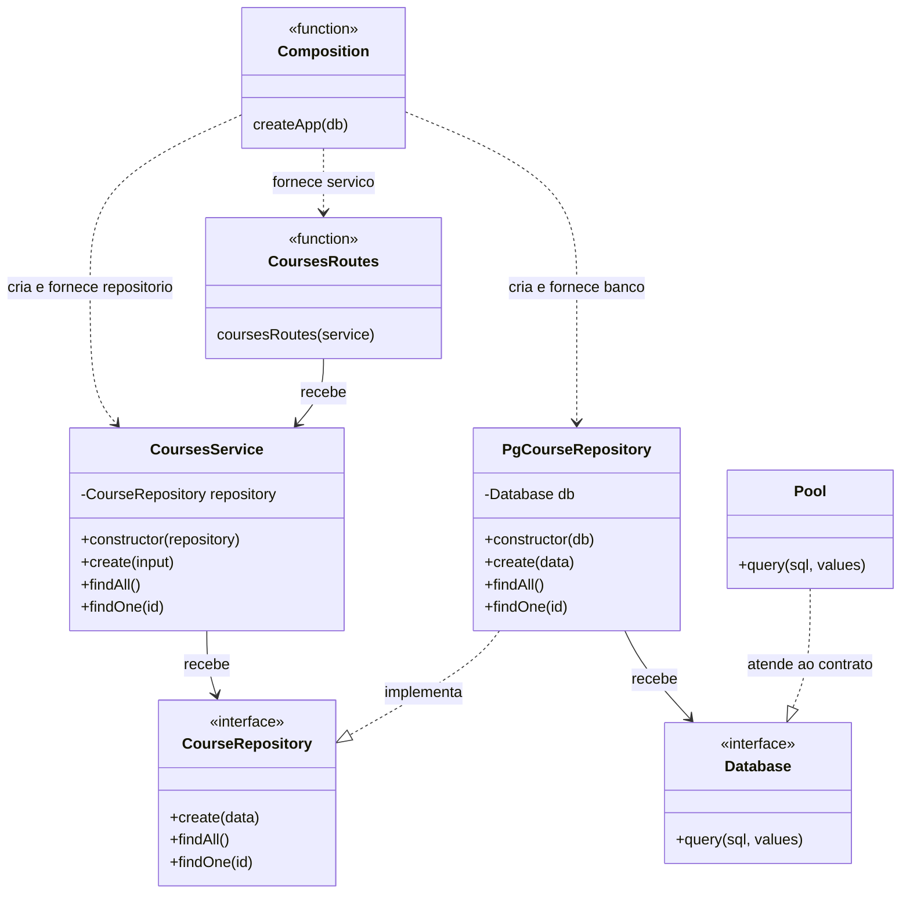
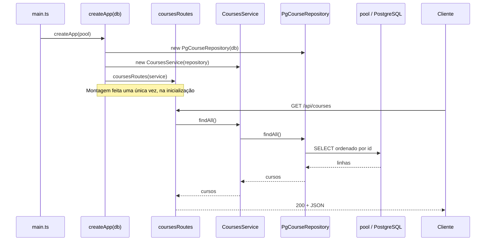

# Injeção de dependência em Express + TypeScript


API REST para cadastro de **alunos**, **cursos** e **matrículas**, construída com Express, TypeScript e PostgreSQL. O foco do projeto é a **injeção de dependência (DI)** aplicada de ponta a ponta, sem nenhum framework ou contêiner de DI: apenas construtores, interfaces e uma raiz de composição.

> **Atividade de avaliação 3** · Desenvolvimento Web II · Fatec Jacareí
> Projeto base e enunciado: [arleysouza/webII-2026-2-dependencia](https://github.com/arleysouza/webII-2026-2-dependencia)
>
> **Autor:** [Guilherme Matos Paiva](https://github.com/gm-paiva) · **RA:** [2581392613035]

## Sumário

- [Objetivo](#objetivo)
- [O que foi feito](#o-que-foi-feito)
- [Arquitetura](#arquitetura)
- [Estrutura do projeto](#estrutura-do-projeto)
- [Como executar](#como-executar)
- [API](#api)
- [Como verificar os critérios da atividade](#como-verificar-os-critérios-da-atividade)
- [Tecnologias](#tecnologias)

## Objetivo

Implementar a injeção de dependência nos módulos `courses` (cursos) e `enrollments` (matrículas), seguindo o exemplo já pronto do módulo `students` (alunos), **sem alterar o comportamento da API**: mesmos endpoints, corpos JSON, validações, códigos HTTP e consultas SQL.

### O que é injeção de dependência?

Uma *dependência* é um objeto de que outro precisa para trabalhar. Aqui, o serviço precisa de um repositório e o repositório precisa de uma conexão com o banco. **Injetar** é fornecer essas dependências *de fora*, em vez de criá-las dentro de quem as usa:

```ts
// Antes: o serviço escolhe e instancia a implementação concreta.
export class CoursesService {
  private readonly repository = new PgCourseRepository();
}

// Depois: o serviço recebe qualquer objeto que cumpra o contrato.
export class CoursesService {
  constructor(private readonly repository: CourseRepository) {}
}
```

Com isso, o serviço depende de um **contrato** (`CourseRepository`) e não de detalhes de SQL ou de PostgreSQL. Trocar a implementação (por exemplo, por um repositório em memória para testes) não exige mexer no serviço.

## O que foi feito

| Camada | Antes (cursos e matrículas) | Depois |
| --- | --- | --- |
| **Repositório** | Importava e usava o `pool` diretamente. | Recebe `Database` pelo construtor e implementa a interface `CourseRepository` / `EnrollmentRepository`. |
| **Serviço** | Criava o repositório com `new`. | Recebe o contrato do repositório pelo construtor. |
| **Rotas** | Criavam o serviço com `new`. | Recebem o serviço por parâmetro (`coursesRoutes(service)`, `enrollmentsRoutes(service)`). |
| **Composição** | `app.ts` chamava as rotas sem fornecer nada. | `app.ts` monta toda a cadeia usando o `db` recebido em `createApp(db)`. |

Alterações por arquivo:

- `courses.repository.ts` e `enrollments.repository.ts`: criação das interfaces `CourseRepository` e `EnrollmentRepository`; classes `Pg*` passam a usar `implements`; `Database` recebido por construtor; remoção do import do `pool`.
- `courses.service.ts` e `enrollments.service.ts`: o construtor passa a depender da **interface**, não da classe concreta `Pg*`.
- `courses.routes.ts` e `enrollments.routes.ts`: recebem o serviço (importado com `import type`, como em `students`).
- `app.ts`: único lugar onde os objetos são criados com `new`.

## Arquitetura

### Raiz de composição

O único lugar que conhece as classes concretas é o `createApp`, em [`server/src/app.ts`](server/src/app.ts). Cada módulo é montado de dentro para fora: banco → repositório → serviço → rotas.

```ts
export function createApp(db: Database) {
  // ...
  const studentRepository = new PgStudentRepository(db);
  const courseRepository = new PgCourseRepository(db);
  const enrollmentRepository = new PgEnrollmentRepository(db);

  const studentsService = new StudentsService(studentRepository);
  const coursesService = new CoursesService(courseRepository);
  const enrollmentsService = new EnrollmentsService(enrollmentRepository);

  app.use("/api/students", studentsRoutes(studentsService));
  app.use("/api/courses", coursesRoutes(coursesService));
  app.use("/api/enrollments", enrollmentsRoutes(enrollmentsService));
  // ...
}
```

E o `pool` do PostgreSQL entra na aplicação em um único ponto, [`server/src/main.ts`](server/src/main.ts):

```ts
const app = createApp(pool);
```

### Diagrama de classes (cursos)

Os três módulos seguem o mesmo padrão. O diagrama mostra `courses`; `enrollments` é idêntico, trocando os nomes (`EnrollmentsRoutes`, `EnrollmentsService`, `EnrollmentRepository`, `PgEnrollmentRepository`).



O `Pool` da biblioteca `pg` atende à interface `Database` por compatibilidade estrutural do TypeScript, sem precisar declarar `implements`.

### Diagrama de sequência

Montagem na inicialização e o caminho de sucesso de uma requisição `GET /api/courses`:



## Estrutura do projeto

```text
.
├── compose.yml                 # database + server + front
├── .env.example                # modelo das variáveis de ambiente
├── database/
│   ├── Dockerfile
│   ├── init.sql                # tabelas students, courses, enrollments
│   └── seed.sql                # dados iniciais
├── front/                      # interface web (Nginx): "Laboratório REST"
│   ├── index.html
│   ├── app.js
│   ├── style.css
│   └── nginx.conf
└── server/
    ├── Dockerfile
    ├── package.json
    └── src/
        ├── main.ts             # injeta o pool e inicia o servidor
        ├── app.ts              # raiz de composição
        ├── errors.ts           # HttpError
        ├── validation.ts       # validação de entrada
        ├── database/
        │   ├── connection.ts   # pool + interface Database
        │   ├── unique-violation.ts
        │   └── foreign-key-violation.ts
        └── modules/
            ├── students/       # rotas, serviço e repositório
            ├── courses/        # rotas, serviço e repositório
            └── enrollments/    # rotas, serviço e repositório
```

Cada módulo tem três camadas: **rotas** (HTTP) → **serviço** (validação e regras) → **repositório** (SQL parametrizado).

## Como executar

### Com Docker (recomendado)

Pré-requisitos: Docker e Docker Compose.

```powershell
# 1. Copie o modelo de variáveis de ambiente (apenas se ainda não tiver um .env)
Copy-Item .env.example .env

# 2. Suba banco, API e interface web
docker compose up -d --build
```

> No Linux/macOS, use `cp .env.example .env` no primeiro passo.

| Recurso | Endereço |
| --- | --- |
| Interface web | http://localhost:8080 |
| API de alunos | http://localhost:3002/api/students |
| API de cursos | http://localhost:3002/api/courses |
| API de matrículas | http://localhost:3002/api/enrollments |
| Health check | http://localhost:3002/health |
| PostgreSQL | `localhost:5433` |

Na primeira inicialização, o banco executa `database/init.sql` e `database/seed.sql` (3 alunos, 39 cursos e 22 matrículas de exemplo). Os dados persistem no volume `atv3_database_data`.

Para encerrar:

```powershell
docker compose down        # mantém os dados
docker compose down -v     # remove também o volume (reseta o banco)
```

### Desenvolvimento local (sem containerizar a API)

Suba apenas o banco e rode a API com recarga automática. Como a API roda fora do Docker, aponte `DB_HOST` e `DB_PORT` para a porta publicada no host:

```powershell
docker compose up -d database

cd server
npm ci
$env:DB_HOST = "localhost"; $env:DB_PORT = "5433"
npm run dev
```

A API fica em `http://localhost:3000` (valor de `SERVER_PORT` no `.env`).

### Scripts (`server/`)

| Comando | Descrição |
| --- | --- |
| `npm run dev` | Executa com `tsx` e recarrega ao salvar. |
| `npm run typecheck` | Verifica os tipos sem gerar arquivos. |
| `npm run build` | Compila TypeScript para `dist/`. |
| `npm start` | Executa a versão compilada. |

## API

Os exemplos usam a porta `3002` (padrão do `.env.example`).

| Método | Rota | Descrição | Corpo (JSON) | Sucesso |
| --- | --- | --- | --- | --- |
| GET | `/health` | Verifica se a API está no ar. | — | `200` |
| GET | `/api/students` | Lista alunos (ordenados por nome). | — | `200` |
| POST | `/api/students` | Cadastra um aluno. | `{ "ra": 258004, "name": "Fulano de Tal" }` | `201` |
| GET | `/api/students/:ra` | Busca um aluno pelo RA. | — | `200` |
| GET | `/api/courses` | Lista cursos (ordenados por id). | — | `200` |
| POST | `/api/courses` | Cadastra um curso. | `{ "name": "Computação Gráfica" }` | `201` |
| GET | `/api/courses/:id` | Busca um curso pelo id. | — | `200` |
| GET | `/api/enrollments` | Lista matrículas. | — | `200` |
| POST | `/api/enrollments` | Matricula um aluno em um curso. | `{ "studentRa": 258001, "courseId": 8 }` | `201` |
| GET | `/api/enrollments/student/:studentRa/course/:courseId` | Busca uma matrícula. | — | `200` |

### Exemplos

```bash
# Listar cursos
curl http://localhost:3002/api/courses

# Cadastrar curso
curl -X POST http://localhost:3002/api/courses \
  -H "Content-Type: application/json" \
  -d '{"name": "Computação Gráfica"}'

# Matricular o aluno 258001 no curso 8
curl -X POST http://localhost:3002/api/enrollments \
  -H "Content-Type: application/json" \
  -d '{"studentRa": 258001, "courseId": 8}'
```

No PowerShell:

```powershell
Invoke-RestMethod -Method Post -Uri http://localhost:3002/api/courses `
  -ContentType "application/json" `
  -Body '{"name": "Computação Gráfica"}'
```

Também é possível testar tudo pela interface web em http://localhost:8080.

### Erros

Entradas inválidas, registros ausentes e conflitos são tratados em um único ponto (`app.ts`) e retornam sempre o mesmo formato:

| Código | Quando acontece |
| --- | --- |
| `400` | Corpo ou parâmetro inválido, ou JSON malformado. |
| `404` | Aluno, curso ou matrícula inexistente; rota inexistente; aluno ou curso inexistente ao matricular. |
| `409` | RA já cadastrado, nome de curso já cadastrado ou aluno já matriculado no curso. |
| `413` | Corpo da requisição grande demais. |
| `500` | Erro interno inesperado. |

```json
{
  "statusCode": 404,
  "message": "Curso com ID 99 não encontrado.",
  "error": "Not Found"
}
```

## Como verificar os critérios da atividade

| Critério | Como conferir |
| --- | --- |
| Serviços recebem **contratos** de repositório e não instanciam repositórios concretos. | `CoursesService` e `EnrollmentsService` declaram `CourseRepository` / `EnrollmentRepository` no construtor. |
| Repositórios recebem `Database` e não importam o `pool`. | Só `main.ts` e `database/connection.ts` mencionam `pool`. |
| Rotas recebem os serviços e não os instanciam. | `coursesRoutes(service)` e `enrollmentsRoutes(service)`. |
| Montagem em `app.ts`, com o mesmo `db` da aplicação. | Todos os `new Pg*` e `new *Service` estão em `createApp(db)`. |
| Tipos e compilação passam. | `npm run typecheck` e `npm run build` terminam sem erros. |

Comandos de verificação (a partir da raiz do repositório):

```bash
# Tipos e compilação
cd server && npm ci && npm run typecheck && npm run build

# Nenhum arquivo fora de main.ts e connection.ts deve citar "pool"
grep -rn "pool" server/src --include=*.ts

# Nenhum "new Pg*" ou "new *Service" fora de app.ts
grep -rnE "new (Pg|[A-Za-z]+Service)" server/src --include=*.ts
```

No PowerShell, o equivalente do `grep` é:

```powershell
Get-ChildItem server/src -Recurse -Filter *.ts | Select-String "pool"
```

## Tecnologias

- [Node.js](https://nodejs.org/) 24 e [TypeScript](https://www.typescriptlang.org/)
- [Express](https://expressjs.com/) 5
- [PostgreSQL](https://www.postgresql.org/) 18 com o driver [`pg`](https://node-postgres.com/)
- [Docker](https://www.docker.com/) e Docker Compose
- [Nginx](https://nginx.org/) para servir a interface web e encaminhar `/api` para a API
